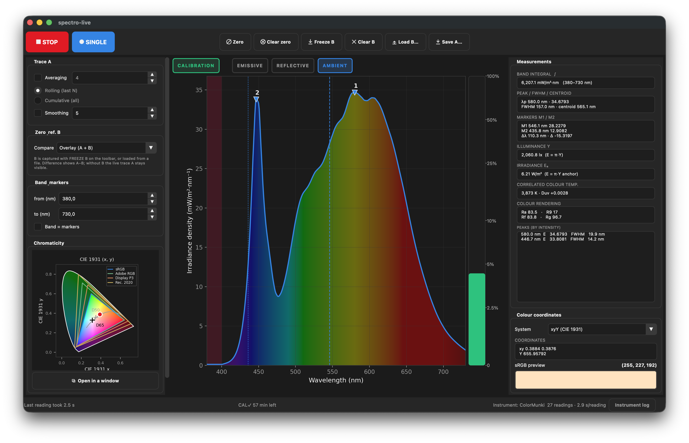
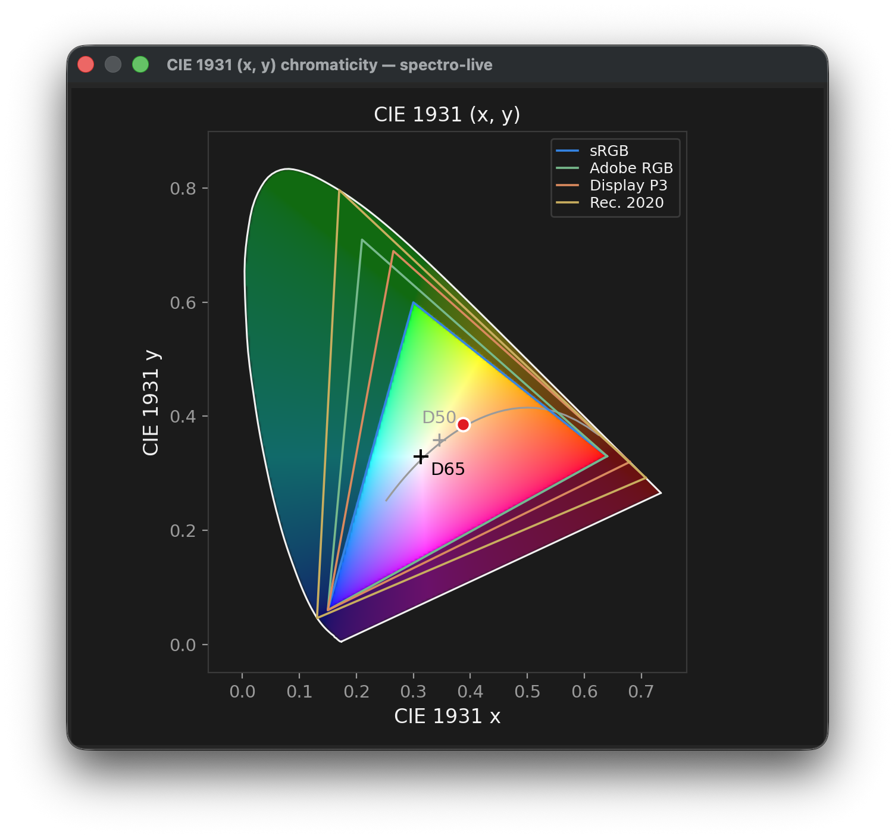

# Spectro-Live

Realtime-style spectrum viewer for spot-reading spectrometers and
spectrophotometers — it works with any instrument driven by
**ArgyllCMS `spotread`**. The app was originally built for the
**X-Rite ColorMunki Photo**, and so far it has only been tested on that
one instrument. It has the kind of features you'd expect from an
optical spectrometer console: averaging, smoothing, integration bands,
zero/background subtraction, A/B reference comparison, wavelength markers,
peak analysis and colorimetry.



The chromaticity diagram can also be detached into its own resizable window,
showing the CIE 1931 horseshoe with the sRGB / Adobe RGB / Display P3 /
Rec. 2020 gamuts around D50 and D65:



## Quick start

```sh
git clone https://github.com/serniko97/Spectro-Live.git   # then:
cd Spectro-Live
python3 -m venv .venv
.venv/bin/pip install -r requirements.txt
./spectro-live                 # GUI
./spectro-live --source simulator --start   # demo without hardware
```

## Sources

* **ColorMunki / i1 Pro / … (spotread)** — drives `spotread -v -s -T`
  through a PTY, because it needs a terminal for its key prompts.
  Emissive, ambient and reflective modes (`-e` / `-a`), high-resolution
  spectral output (`-H`), and `-c N` to pick one of several connected
  instruments. In ambient mode the CCT/CRI/TM-30 output is enabled
  automatically. XYZ-only colorimeters
  supported.
* **Simulator** — synthetic fluorescent / LED / incandescent / dark spectra so
  everything can be exercised without hardware.

## Instrument / workflow notes

* Works with any instrument ArgyllCMS supports (ColorMunki
  Photo/Design/Display, i1 Pro family, colorimeters like Spyder5, …);
  with several connected, pick one under **Instrument → Device…**.
  Reading modes auto-restrict to what the hardware supports
  (wheel-slot hints are ColorMunki-only; other instruments follow the
  caption text).
* **The annunciator lamps are the mode selector**: EMISSIVE,
  REFLECTIVE and AMBIENT are clickable (selected = blue border);
  CALIBRATION turns green while valid — click it to recalibrate every
  mode. Mode changes restart the session with one automatic
  re-calibration.
* **ColorMunki wheel: 1 = off, 2 = calibration, 3 = measuring** (front
  aperture: emissive and reflective); the **outer slot past OFF =
  ambient** (top diffuser). Calibration is fully automatic: the app
  answers spotread's prompts itself, and one wheel-at-2 pass calibrates
  *all three* modes (Argyll keeps a separate calibration per mode; the
  lamp fills a quarter per completed mode).
* **Calibration is cached** by ArgyllCMS on this computer (dark cal
  valid 1 h, reflective white 24 h): within those windows USB blips and
  mode switches resume measuring with no calibration dance. The
  status-bar countdown is rebuilt from the last real
  calibration's timestamp, so it keeps ticking across app restarts.
  **Instrument → Force calibration** demands a fresh calibration at
  every session start instead — spotread itself still asks whenever
  the cache is genuinely stale.
* **Physical button**: fixed by spotread as a one-reading hardware
  trigger. While the app is **stopped**, readings (late ones, or a
  flood from a held or defective button) are dropped — the trace never
  moves; use ⏺ SINGLE for one deliberate measurement.
* `spotread` must be in PATH (Fedora: `sudo dnf install argyllcms`); a
  different ArgyllCMS build can be selected with **Instrument →
  ArgyllCMS spotread path…**, and **Use default spotread (from PATH)**
  reverts.
* **The ColorMunki's first spectral bins are clones, not data** (short
  of the sensor's real range start; down to 420 nm for reflective).
  The region is shaded bordeaux on the chart,
  and **Instrument → Ignore unreliable band** removes it from every
  measurement, the colour data and exports (XYZ is recomputed from the
  trusted band). Other instruments: no highlight, clip is a no-op.
* If the USB device disappears ("Device disconnected" in the status
  bar), the app keeps polling and resumes automatically when it
  re-appears; a recalibration while stopped never restarts measuring
  on its own.

## Views

* **View → Units**: raw counts · V(λ)-weighted (a.u. shape view — the
  eye's perceptual weighting, no cd/m² claim) · photometric absolute
  (cd/m²·nm⁻¹ luminance / lx·nm⁻¹ illuminance = π·Y, scaled so the
  integral equals the instrument's calibrated Y) · radiometric absolute
  (the exact W/(sr·m²) / W/m² counterpart, V(λ) undone) · reflectance %.
  A reflectance factor is dimensionless, so reflective mode falls back
  to the plain reflectance curve for both absolute views; with no
  calibrated Y anchor they honestly show nothing.
* **View → Axis**: wavelength / frequency (THz) / photon energy (eV) —
  presentation only; markers, the band and every analysis stay in
  nanometres and plot clicks convert back automatically.
* **View → Curve style**: straight segments (default), overshoot-free
  monotone smoothing, or sample-and-hold steps — applied instantly, no
  new measurement needed.
* **View → Chromaticity**: CIE 1931 (x, y), 1976 (u′, v′) or 1960
  (u, v) — the diagram shows true-colour sRGB inside the gamut
  triangles (sRGB, Adobe RGB, Display P3, Rec. 2020), D65/D50, and the
  gray Planckian line; **Open in a window** detaches a resizable copy.
* **Saturation bar** (right of the plot): how close the busiest sensor
  channel is to the end of its linear range — log scale, 100 % = the
  sensor's analog knee. Steady red means the brightest channels are no
  longer quantitative (flashing red well past the knee, or whenever
  spotread reports "Sensor is saturated"). The ceiling is claimed only
  where it can be substantiated per instrument
  (ColorMunki, DTP20); everything else — and all reflective
  readings — reads n/a.

### Platforms

**Linux** is the primary platform: udev exposes the ColorMunki at
`/dev/hidraw*` after your distribution's Argyll udev rules, and device
presence is scanned from sysfs.

**macOS** is supported. `system_profiler` may not list Argyll
instruments at all (the ColorMunki enumerates with a vendor-specific
USB interface class), so on macOS `spotread` itself is the arbiter of
whether an instrument is connected; Argyll's calibration cache is
read from `~/Library/Caches/ArgyllCMS`.

**Windows** is supported. The instrument session runs `spotread`
inside a Windows pseudo-console (**ConPTY**, via the optional
`pywinpty` dependency — without it sessions hang at spotread's first
key prompt). The USB scan uses PowerShell
`Get-CimInstance Win32_PnPEntity`, and Argyll's calibration cache is
read from `%APPDATA%\Cache\ArgyllCMS`. With multiple instruments use
*Auto (first found)*; the ColorMunki may need the usual one-time
[Zadig](https://zadig.akeo.ie/) / libusb driver install for Argyll.

## Features

| Where | What |
| --- | --- |
| Averaging | rolling (last *N*) or cumulative mean over raw frames |
| Smoothing | moving-average with adjustable window |
| Zero | capture the current RAW reading as the new zero — pressing Zero again re-zeros (never undoes; only Clear zero removes it). While active the button is highlighted and everything (integral, peaks, chromaticity, colour coordinates) is computed from the corrected curve, with XYZ recomputed from it; saved CSVs are flagged `# zero_corrected` |
| Reference B | freeze the current processed trace or load from file; views: overlay, difference (A−B), ratio A/B % |
| Integration | trapezoidal ∫ over a band; band can follow the two markers |
| Markers | M1/M2 wavelength cursors (left/right mouse click on the plot), Δλ, intensity at each marker, Δ (intensity difference) |
| Peaks | λpeak, FWHM (linear interpolated half-max crossing), spectral centroid, peak table in the right panel (and written into every saved CSV). Peak **honesty rules**: endpoints count (a curve still rising into 730 nm genuinely peaks there), a bump counts by its height above the saddle between its own flanking valleys (not a global baseline), flat tops yield ONE peak, and a robust noise floor (4×σ from second differences) keeps jitter on a plateau from flooding the list |
| Colorimetry | CIE xy and CCT **with Duv** (instrument-reported, or computed from the spectrum with the CIE 1931 observer); photometric Y per mode (cd/m² / **lx = π·Y** ambient per Argyll's Lambertian-field model / %) **plus the exact radiometric counterpart**: radiance **W/(sr·m²)** pairing with the cd/m² (emissive) and irradiance **W/m²** pairing with the lx (ambient), derived as Xₑ = Xᵥ·∫S dλ/(683·∫S·V dλ) — the absolute scale anchored to the instrument's calibrated Y, the spectrum supplying the shape that undoes the photopic weighting (n/a for surfaces: reflectance is dimensionless); CRI Ra + R9 (spotread's own value and validity flag preferred) **and IES TM-30-15 Rf/Rg** (the modern fidelity/gamut pair, printed by spotread `-T` whenever your Argyll version provides it — instrument-reported with Argyll's own Caution flag, honest "absent" when not printed); sRGB preview with gamut report (sRGB, Adobe RGB, Display P3, Rec. 2020) |
| Logging | all **opt-in, off by default**: auto-log every reading to `~/spectro-live-logs/session-*.csv`, and the full spotread transcript to `~/spectro-live-logs/instrument-log-*.txt` via **Instrument → Write instrument log** (can be turned on mid-session; keeps what it wrote when turned off) |
| Export | traces and references as CSV, plot as PNG; load spectra from CSV / Argyll `.sp` / CGATS |

## Processing chain

```
raw frame → subtract zero (per frame) → average (rolling/cumulative)
         → smooth → trace A
                       ├── overlay / A−B / A÷B vs reference B
                       └── stats: integral, peak/FWHM/centroid, xy/CCT
```


## Acknowledgements

This project could not exist without **[ArgyllCMS](https://www.argyllcms.com/)**
(Graziano Plegagnolu): every measurement flows through its `spotread`
driver, and its source was the reference for the instrument's behaviour
that this UI wraps. The colorimetry itself uses the CIE 1931 standard
observer, McCamy's
CCT approximation, and the CIE CRI / IES TM-30 methods as printed by Argyll.

## License

Copyright © 2026 Nicola Serra

Spectro-Live is free software: you can redistribute it and/or modify it
under the terms of the **GNU General Public License as published by the
Free Software Foundation, either version 3 of the License, or (at your
option) any later version**. See [LICENSE](LICENSE) for the full text.
It depends on — but does not include — [ArgyllCMS](https://www.argyllcms.com/)
(AGPL), which you install separately.
